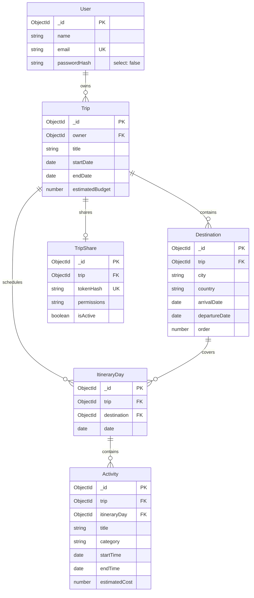

# Globe Trotter 🌍 — Personalized Travel Planning Platform

> **Academic Project Note**: Globe Trotter is a full-stack, personalized **travel-PLANNING** web application. It helps travelers design itineraries, structure multi-city destinations, schedule daily activities, analyze trip budgets, and securely share itineraries with travel companions. It is strictly a planning and organizational platform—it is **NOT** a booking engine (no flight/hotel booking, no payment gateways, and no third-party paid APIs).

---

## 1. Features List (Mapped to Core Modules)

Globe Trotter is organized into eight coherent modules:

| # | Module | Key Capabilities |
| :--- | :--- | :--- |
| **1** | **Authentication & Security** | User registration and login, password hashing using bcryptjs (salt cost 10), stateless JWT tokens with 7-day expiration, rate limiting on auth endpoints (50 req / 15 min), and profile management (display name update, password change with current password verification). |
| **2** | **Trip Management** | Complete CRUD operations for travel trips. Validates that start date precedes end date. Prevents shrinking trip dates if existing destinations fall outside the new window. Implements clean cascade deletion of all child destinations, itinerary days, activities, and share links upon trip removal. |
| **3** | **Destination Routing** | Multi-city destination sequencing with automatic zero-indexed ordering (`0..N-1`). Date boundaries validated against trip window. Safe reordering mechanism using temporary negative sequence keys to avoid compound index collisions. |
| **4** | **Itinerary Synchronization (`resyncDays`)** | Automatic generation and synchronization of calendar itinerary days from destination date ranges. Automatically assigns shared transit boundary dates to the later destination (the city arrived in). Prevents silent deletion of activities by rejecting destination removals or shrinkages that would orphan scheduled activities. |
| **5** | **Activity Scheduling** | Day-by-day activity creation with title, description, location, start/end times, and estimated costs. Categorized into 7 standard travel types: `sightseeing`, `accommodation`, `food`, `transport`, `activities`, `shopping`, and `other`. Chronologically sorted by start time. |
| **6** | **Live Budget Aggregation & Analytics** | Real-time MongoDB aggregation pipelines computing total planned expenses, remaining balance, and over-budget status. Features a prominent warning alert when budgets are exceeded. Visualized using **Recharts** interactive donut chart for category distribution and bar charts for daily expenditures. |
| **7** | **Secure Public Itinerary Sharing** | One-click itinerary link generation. Uses cryptographic 32-byte tokens stored as SHA-256 hashes in MongoDB. Raw token revealed only once upon creation. Instant revocation. Public endpoint (`/shared/:token`) returns a sanitized, read-only view with zero owner or private identity data leaked. |
| **8** | **Design System & Responsive UI** | Built with React, Vite, TypeScript, and Tailwind CSS. Modern travel palette (teal and sky blue with warm amber accents). Custom UI components: modal dialogs with backdrop blur, confirmation modals, auto-dismissing toast notifications, accessible badges, and a collapsible mobile navbar. |

---

## 2. Technology Stack

### Frontend (Client)
- **Framework**: [React 18](https://react.dev/) + [Vite](https://vitejs.dev/) + [TypeScript](https://www.typescriptlang.org/)
- **Routing**: [React Router v6](https://reactrouter.com/) (protected routes, public-only redirects)
- **Styling**: [Tailwind CSS v3.4](https://tailwindcss.com/) with PostCSS
- **Data Visualization**: [Recharts](https://recharts.org/) (responsive pie/donut and bar charts)
- **Icons**: [Lucide React](https://lucide.dev/)
- **Currency**: Centralized Indian Rupee (`₹`) symbol formatting

### Backend (Server)
- **Runtime**: [Node.js](https://nodejs.org/) (LTS)
- **Framework**: [Express 4](https://expressjs.com/) with TypeScript
- **Database Driver**: [Mongoose 8](https://mongoosejs.com/)
- **Validation**: [Zod 3](https://zod.dev/) (strict request body validation)
- **Security**: [Helmet](https://helmetjs.github.io/), [CORS](https://github.com/expressjs/cors), [express-rate-limit](https://github.com/express-rate-limit/express-rate-limit)
- **Authentication**: [jsonwebtoken](https://github.com/auth0/node-jsonwebtoken) + [bcryptjs](https://github.com/dcodeIO/bcrypt.js)

### Database
- **Database**: Local **MongoDB Community Server** (v7/v8) running as a dedicated user-space instance strictly isolated on `D:\` drive (Port `27018`).
- **Data Model**: Normalized relational schemas (Users, Trips, Destinations, ItineraryDays, Activities, TripShares) with compound indexes and cascade delete guarantees.

---

## 3. Storage Architecture Note (Strict D: Drive Isolation)

To accommodate machines with constrained system drives (e.g. C: with <3.5 GB free space), Globe Trotter is architected to execute with **zero footprint on C:**:
- **Workspace**: Everything resides within `D:\GlobeTrotter\`.
- **npm Cache**: Project `.npmrc` files and terminal session variables redirect package caching strictly to `D:\GlobeTrotter\.npm-cache`.
- **Temp Directories**: Temporary files are redirected to `D:\Temp` via `$env:TEMP` and `$env:TMP`.
- **MongoDB Data & Logs**: Database storage is bound to `D:\MongoDB\data\` and logs to `D:\MongoDB\log\mongod.log`.
- **Dedicated Port**: Dedicated to port `27018`, leaving the default Windows service on port `27017` untouched.

---

## 4. Project Folder Structure

```text
D:\GlobeTrotter\
├── .npmrc                          # Global npm cache redirection to D:\GlobeTrotter\.npm-cache
├── .gitignore                      # Ignores node_modules, dist, .env, and local caches
├── README.md                       # Complete project guide and documentation
├── scripts\
│   └── start-mongodb.ps1           # Starts standalone MongoDB instance on port 27018 pointing to D:\MongoDB
├── docs\
│   └── SCREENSHOT-CHECKLIST.md     # Presentation and report capture checklist
├── client\                         # React + Vite + TypeScript Frontend
│   ├── .npmrc                      # Local cache pointer
│   ├── vite.config.ts              # Port 5173 dev server, proxies /api -> http://localhost:5000
│   ├── tailwind.config.js          # Travel-themed custom colors & font settings
│   ├── src\
│   │   ├── components\             # UI components, modals, and tab views
│   │   │   ├── ui\                 # Button, Input, Select, Card, Modal, Alert, Badge, etc.
│   │   │   ├── trips\              # DestinationsTab, ItineraryTab, BudgetTab, TimelineTab, ShareTab
│   │   │   ├── destinations\       # DestinationModal
│   │   │   ├── activities\         # ActivityModal
│   │   │   └── ProtectedRoute.tsx  # Protected and public route guards
│   │   ├── context\                # AuthContext (JWT & user state), ToastContext
│   │   ├── layouts\                # AppLayout (responsive top navbar with mobile collapse)
│   │   ├── pages\                  # Landing, Login, Register, Dashboard, TripDetail, Profile, PublicShared
│   │   ├── services\               # api.ts (fetch client with auto-Bearer and 401 handling)
│   │   ├── types\                  # TypeScript interface domain models
│   │   └── utils\                  # Currency and date formatters
│   └── package.json
└── server\                         # Node.js + Express + TypeScript Backend
    ├── .npmrc                      # Local cache pointer
    ├── .env.example                # Sample environment variables
    ├── .env                        # Local secrets (excluded from git)
    ├── scripts\
    │   ├── verify-db.ts            # Verifies Mongoose connection, models, and compound indexes
    │   ├── test-api.ts             # 23 automated integration tests
    │   └── seed-demo.ts            # Seeds demo account with 3-city Rajasthan trip & activities
    ├── src\
    │   ├── config\                 # db.ts (Mongoose connection & graceful shutdown)
    │   ├── controllers\            # auth, trip, destination, itinerary, activity, budget, share
    │   ├── middleware\             # auth (JWT Bearer verify), validate (Zod), errorHandler
    │   ├── models\                 # User, Trip, Destination, ItineraryDay, Activity, TripShare
    │   ├── routes\                 # auth.routes, trip.routes, shared.routes, health.routes
    │   ├── services\               # Business logic, aggregation pipelines, resyncDays
    │   ├── validators\             # Zod input validation schemas
    │   ├── types\                  # Express authenticated request typings
    │   ├── app.ts                  # Express application setup, helmet, cors
    │   └── index.ts                # Server startup on port 5000
    └── package.json
```

---

## 5. Prerequisites & Environment Variables

### Prerequisites
- **Node.js**: v18.0.0 or higher
- **npm**: v9.0.0 or higher
- **MongoDB Community Server**: v7.0 or higher installed at `C:\Program Files\MongoDB\Server\<version>\bin\mongod.exe`
- **Operating System**: Windows with PowerShell

### Environment Variables

#### Server (`server/.env`)
```ini
PORT=5000
CLIENT_URL=http://localhost:5173
NODE_ENV=development
MONGODB_URI=mongodb://127.0.0.1:27018/globetrotter
JWT_SECRET=your_super_secret_jwt_key_min_32_characters_random_string_here
JWT_EXPIRES_IN=7d
```

#### Client (`client/.env`)
```ini
VITE_API_URL=/api
```
*(During development, Vite forwards all `/api` calls directly to `http://localhost:5000` via its internal proxy, eliminating CORS complexity).*

---

## 6. First-Time Setup & Execution Guide

To run Globe Trotter, open **three separate PowerShell terminal windows**. Ensure that in every terminal you keep session cache pointers directed to the `D:\` drive:

### Terminal 1: MongoDB Daemon (Port 27018)
```powershell
$env:npm_config_cache = "D:\GlobeTrotter\.npm-cache"
$env:TEMP = "D:\Temp"
$env:TMP = "D:\Temp"

powershell -ExecutionPolicy Bypass -File "D:\GlobeTrotter\scripts\start-mongodb.ps1"
```
*(Leave running. MongoDB data is safely isolated in `D:\MongoDB\data\` and logs in `D:\MongoDB\log\mongod.log`).*

### Terminal 2: Express Backend Server (Port 5000)
```powershell
Set-Location "D:\GlobeTrotter\server"
$env:npm_config_cache = "D:\GlobeTrotter\.npm-cache"
$env:TEMP = "D:\Temp"
$env:TMP = "D:\Temp"

# 1. Install dependencies (if first time)
npm install

# 2. Seed demo presentation data
npm run seed:demo

# 3. Start development server
npm run dev
```
*(The backend is live at `http://localhost:5000`. Health checks: `http://localhost:5000/api/health` and `http://localhost:5000/api/health/db`).*

### Terminal 3: React Frontend Client (Port 5173)
```powershell
Set-Location "D:\GlobeTrotter\client"
$env:npm_config_cache = "D:\GlobeTrotter\.npm-cache"
$env:TEMP = "D:\Temp"
$env:TMP = "D:\Temp"

# 1. Install dependencies (if first time)
npm install

# 2. Start client dev server
npm run dev
```
*(Open your browser at **`http://localhost:5173`** to access the web application).*

---

## 7. Available Scripts Summary

| Directory | Command | Description |
| :--- | :--- | :--- |
| `server\` | `npm run seed:demo` | Seeds demo account (`demo@globetrotter.test`) with a sample Rajasthan tour, 3 cities, 5 days, and 11 activities. Idempotent and re-runnable. |
| `server\` | `npm run test:api` | Executes the complete 23-step automated end-to-end integration test suite. |
| `server\` | `npm run verify:db` | Connects to port 27018, synchronizes indexes, and performs a complete CRUD test of all 6 schemas. |
| `server\` | `npm run build` | Compiles server TypeScript files into `dist/` with zero errors. |
| `server\` | `npm run start` | Runs the compiled server production build from `dist/index.js`. |
| `client\` | `npm run build` | Compiles TypeScript and runs Vite production bundling into `dist/`. |
| `client\` | `npm run preview` | Serves the production build locally for testing. |

---

## 8. REST API Endpoint Specification

All endpoints under `/api/trips` require an `Authorization: Bearer <token>` header.

### Authentication (`/api/auth`)
| Method | Path | Description | Auth Required |
| :--- | :--- | :--- | :---: |
| `POST` | `/api/auth/register` | Register new user account (name, email, password min 8) | No |
| `POST` | `/api/auth/login` | Authenticate with credentials and receive JWT | No |
| `GET` | `/api/auth/me` | Fetch currently logged in user profile | **Yes** |
| `PUT` | `/api/auth/me` | Update display name or change password | **Yes** |

### Trips (`/api/trips`)
| Method | Path | Description | Auth Required |
| :--- | :--- | :--- | :---: |
| `GET` | `/api/trips` | List all trips owned by user with computed stats | **Yes** |
| `POST` | `/api/trips` | Create new trip (title, dates, target budget) | **Yes** |
| `GET` | `/api/trips/:tripId` | Fetch full trip details with populated destinations & days | **Yes** |
| `PUT` | `/api/trips/:tripId` | Update trip title, dates, or estimated budget | **Yes** |
| `DELETE` | `/api/trips/:tripId` | Cascade delete trip and all child documents | **Yes** |

### Destinations (`/api/trips/:tripId/destinations`)
| Method | Path | Description | Auth Required |
| :--- | :--- | :--- | :---: |
| `GET` | `/api/trips/:tripId/destinations` | List destinations sorted by order | **Yes** |
| `POST` | `/api/trips/:tripId/destinations` | Add destination stop (auto-generates days via `resyncDays`) | **Yes** |
| `PUT` | `/api/trips/:tripId/destinations/reorder`| Reorder sequence of stops using ordered array of IDs | **Yes** |
| `PUT` | `/api/trips/:tripId/destinations/:id` | Update destination city, country, or dates | **Yes** |
| `DELETE` | `/api/trips/:tripId/destinations/:id` | Remove destination (rejects if dates have activities) | **Yes** |

### Itinerary Days & Activities
| Method | Path | Description | Auth Required |
| :--- | :--- | :--- | :---: |
| `GET` | `/api/trips/:tripId/days` | Fetch chronological itinerary days with activities | **Yes** |
| `POST` | `/api/trips/:tripId/days/:dayId/activities` | Schedule activity on a specific itinerary day | **Yes** |
| `PUT` | `/api/trips/:tripId/activities/:id` | Update activity title, times, category, or cost | **Yes** |
| `DELETE` | `/api/trips/:tripId/activities/:id` | Delete an activity | **Yes** |

### Budget & Sharing
| Method | Path | Description | Auth Required |
| :--- | :--- | :--- | :---: |
| `GET` | `/api/trips/:tripId/budget` | Real-time live MongoDB aggregation of costs by category & day | **Yes** |
| `POST` | `/api/trips/:tripId/share` | Generate 32-byte secure share link (one-time raw reveal) | **Yes** |
| `GET` | `/api/trips/:tripId/share` | Get active sharing status | **Yes** |
| `DELETE` | `/api/trips/:tripId/share` | Revoke active sharing link | **Yes** |
| `GET` | `/api/shared/:token` | Public, read-only itinerary view (zero private leaks) | No |

---

## 9. Database Collections Summary



---

## 10. Demo Account Credentials

Use these credentials to test and present the application:

| Field | Value |
| :--- | :--- |
| **Email** | `demo@globetrotter.test` |
| **Password** | `DemoPassword123!` |
| **Pre-loaded Trip** | *Classic Rajasthan Heritage Tour* (Nov 10 – Nov 14, 2026) |
| **Destinations** | Jaipur (Days 1–2), Jodhpur (Days 2–4), Udaipur (Days 4–5) |
| **Target Budget** | ₹25,000 |
| **Total Planned** | ₹30,600 (Exceeded by ₹5,600, triggering visual alert) |

---

## 11. Five-Minute Presentation Walkthrough Script ⏱️

Follow this script during your project presentation or demonstration:

1. **Introduction & Landing Page (0:00 – 0:45)**:
   - Open `http://localhost:5173`.
   - Explain: *"Globe Trotter is a full-stack personalized travel planner designed to simplify complex multi-city journeys, daily activity scheduling, and live budget tracking."*
   - Highlight the value proposition: planning-focused, privacy-respecting, zero booking fees.
2. **Authentication & Dashboard Overview (0:45 – 1:30)**:
   - Click "Sign In", enter `demo@globetrotter.test` and `DemoPassword123!`.
   - Showcase the Dashboard: point out personalized greeting and the 4 KPI cards (Total Trips, Upcoming Trips, Destinations Planned, Total Budget).
   - Show the trip card for *"Classic Rajasthan Heritage Tour"*, displaying duration (5 days), stop count (3), and total cost.
3. **Multi-City Destinations & Day Synchronization (1:30 – 2:30)**:
   - Click into the trip to open the **Trip Detail** view.
   - Show the **Destinations Tab**: explain the 3 cities (Jaipur, Jodhpur, Udaipur).
   - Demonstrate the native Up/Down reorder controls and show how `resyncDays` automatically handles transit boundary dates (assigning boundary arrival days to the arriving city).
4. **Daily Itinerary Planning (2:30 – 3:30)**:
   - Switch to the **Itinerary Tab**: showcase the day-by-day calendar schedule.
   - Point out the 11 activities across 7 distinct categories (`sightseeing`, `food`, `accommodation`, `transport`, `shopping`), with color-coded badges, start/end times, and costs.
   - Click "Add Activity" to demonstrate the interactive modal with date boundary and time validation.
5. **Budget Analytics & Timeline (3:30 – 4:15)**:
   - Switch to the **Budget Tab**: point out the prominent red **Over-Budget Warning Banner** (Target: ₹25,000 vs Planned: ₹30,600, exceeded by ₹5,600).
   - Hover over the **Recharts interactive donut chart** showing expense percentages by category, and the daily bar chart.
   - Switch to the **Timeline Tab** to show the horizontal day selector and chronological event breakdown.
6. **Public Itinerary Sharing & Wrap-Up (4:15 – 5:00)**:
   - Switch to the **Share Tab**: click "Generate Public Link".
   - Copy the link, open an **Incognito Window**, and paste the URL (`/shared/<token>`).
   - Demonstrate that the public recipient sees the full itinerary and budget breakdown without needing an account, while verifying that zero owner emails or user IDs are exposed.
   - Return to the authenticated window, click "Revoke Link", and show that refreshing the incognito tab immediately yields a secure 404.

---

## 12. Known Limitations & Future Work

In the spirit of honest academic evaluation, the following design boundaries and future enhancements are noted:

1. **Single Currency**: All financial calculations are formatted in Indian Rupees (`₹`). Future work will incorporate multi-currency selection with live exchange rate conversion for international travel.
2. **Local Standalone Database**: Configured for local MongoDB Community Server on port `27018` without distributed replica set transactions. In an enterprise cloud deployment, this would be migrated to a high-availability MongoDB cluster with multi-document ACID transactions.
3. **Public Sharing Access Control**: Shared itineraries currently support read-only permissions (`permissions: 'read'`). Collaborative real-time multi-user editing (e.g., via WebSockets) is a natural future enhancement.
4. **Offline Mode & Caching**: The client relies on an active network connection to the Express API. Future work will introduce a Service Worker with indexedDB local caching to support offline itinerary review in remote travel destinations.
5. **Asset Storage**: Media and maps currently rely on external URL references. Future iterations can integrate local file storage or S3-compatible object buckets for user photo journaling.

# Agile_Globe_trotter
